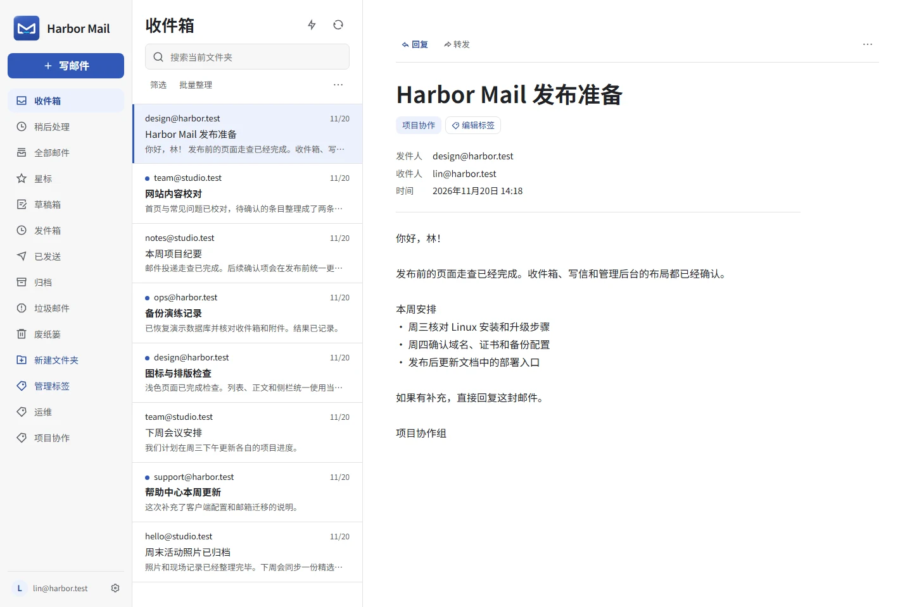
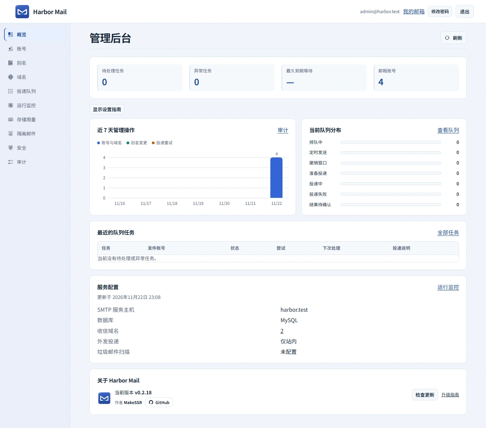
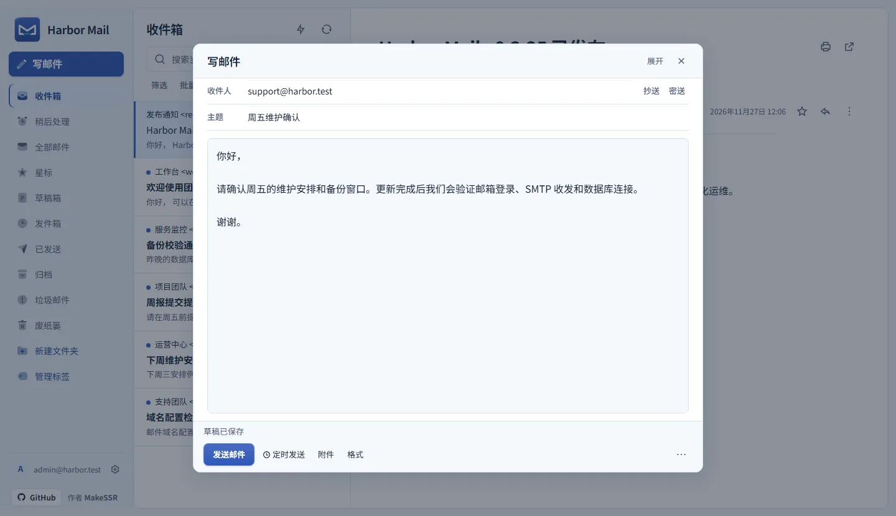
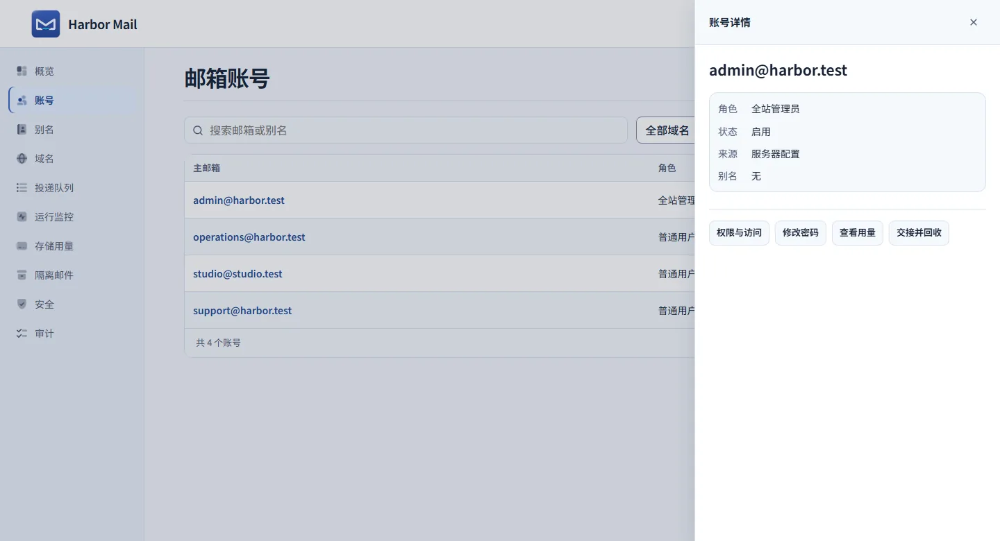

# Harbor Mail


Harbor Mail 是一个自建域名邮箱系统。用户从首页收发邮件，管理员从 `/admin` 管理域名、邮箱、投递队列和隔离邮件。服务端用 Go 编写，网页资源内嵌在单个可执行文件中，支持 Docker Compose 和 Linux systemd 部署。

[下载正式版](https://github.com/makessr/HarborMail/releases/latest) · [第一次部署](docs/quick-start.md) · [完整配置](docs/deployment-and-usage.md) · [生产运行手册](ops/README.md)

## 界面演示

截图来自正式版 **v0.2.18** 的 Docker 标准版。账号、域名、IP 和邮件均为演示数据。

### 网页邮箱

侧栏可切换收件箱、草稿、发件箱和自定义文件夹。阅读页可查看发件人详情、下载原始邮件、打印、回复或转发。



### 管理后台

概览显示账号数、近期管理操作和投递队列。后台也提供别名、配额、扫描隔离与审计管理。



### 域名与 DNS

新增邮件域名后，从「DNS 记录」查看并复制 A、MX、SPF、DKIM 和 DMARC 配置。发布记录后可在后台运行域名上线检查。


<details>
<summary>更多实机截图 · 写邮件、账号管理、存储与运行监控</summary>

#### 写邮件

写信窗口可展开抄送和密送，并提供附件、草稿和定时发送入口。



#### 账号管理

按域名、角色和状态筛选账号，打开详情查看可用管理操作。



#### 存储用量

查看单个邮箱的邮件、文件夹和投递队列用量，并管理容量预警。


#### 运行监控

查看 Harbor 进程 CPU、内存、数据库连接池及后台处理状态。


</details>

## 功能与取舍

| 场景 | 支持内容 |
| --- | --- |
| 网页收发 | 多收件人、抄送和密送、附件、草稿自动保存、定时发送和撤销、授权别名发信、签名与模板 |
| 邮件整理 | 嵌套文件夹、标签、邮件规则、搜索、稍后处理、EML 导入和导出 |
| 邮件客户端 | SMTP 收信与提交、IMAP（含 IDLE）、POP3、TLS、应用密码 |
| 域名和运维 | 多域名、管理员与域管理员、邮箱和别名、DNS 指引、内置 DKIM、投递队列、存储配额、隔离与审计 |
| 可选集成 | SMTP 中继、Cloudflare DNS-01 自动证书、Rspamd 和 ClamAV、旧邮箱 IMAPS 迁移 |

**优点**

- 网页和 IMAP 客户端共用邮箱。可以从 SQLite 单实例起步，也可部署 MySQL、Redis 和来信扫描。
- 多个域名可以在同一后台维护。默认启用原生 MX 直投，也可配置 SMTP 中继。
- 邮箱数据、扫描数据和凭据可独立备份。Docker 默认使用命名卷，当前仓库的 Compose 也支持指定宿主机路径。

**局限**

- 公网收发涉及域名 DNS、证书和邮件端口。直投还取决于出站 TCP 25、IP 信誉和收件方策略。远端返回 SMTP `250` 表示已接收，最终分类由对方决定。
- SQLite 适合单实例。共享 MySQL 时需要维护数据库连接、备份和各实例配置。
- Rspamd 和 ClamAV 增加内存、磁盘及病毒库维护开销。下方的标准版测试未启用扫描。
- 网页发信默认附件合计 6 MiB，编码后整封邮件上限 10 MiB。可配置的最高值分别为 28 MiB 和 40 MiB。 [邮件大小与附件](docs/deployment-and-usage.md#当前范围)

## 部署方案和难度

| 方案 | 难度 | 需要的组件 |
| --- | --- | --- |
| [Docker 极简版](compose.minimal.yaml) | 低，适合体验或轻量单实例 | Harbor Mail 和内置 SQLite |
| [Docker 标准版](compose.standard.yaml) | 中，适合首次长期部署 | Harbor Mail、MySQL 8.4、Redis |
| [Docker 全量版](compose.full.yaml) | 较高，需要等待病毒库就绪并管理扫描策略 | 标准版加 Rspamd、ClamAV 和扫描专用 Redis |
| [Linux 单二进制](ops/README.md#linux-单二进制-systemd-部署) | 中到较高，需要配置 systemd 和所选外部服务 | 极简只使用内置 SQLite，标准和全量按需接入相同的外部组件 |

难度按安装和维护工作量评估。所有方案接入公网前都需要核验 DNS、HTTPS、实际收发和备份恢复。

### 服务器配置推荐

以下是小规模单机部署的起配建议。内存按整台 Linux 主机估算，SSD 容量需要容纳系统、镜像和在线数据，备份另计。

| 部署方案 | CPU | 内存 | SSD | 适用场景 |
| --- | ---: | ---: | ---: | --- |
| 极简版 · SQLite | 1–2 vCPU | 1–2 GiB | 30–50 GiB | 个人邮箱、演示或低并发单实例 |
| 标准版 · MySQL + Redis | 2 vCPU | 4 GiB | 60–100 GiB | 小团队、多个域名，或同机运行 1Panel 和反向代理 |
| 全量版 · 含 Rspamd + ClamAV | 4 vCPU | 8 GiB | 100–200 GiB | 长期开启反垃圾和病毒扫描，并为病毒库更新留出余量 |

**2 核 4 GiB 优先选标准版。** ClamAV 官方为扫描组件本身建议预留 3–4 GiB 内存，病毒库重载时占用会上升。它与 MySQL、1Panel 同机运行时，按全量版起配更合适。 [ClamAV 容器内存说明](https://docs.clamav.net/manual/Installing/Docker.html#memory-ram-requirements)

这些是配置建议，实测范围见[下方测试数据](#实机测试数据)。磁盘按邮箱实际用量、附件增长、索引和数据库日志扩容，并使用独立位置保存备份。 [生产存储与容量规划](ops/README.md#存储上限)

### 配置清单

| 需要准备 | 说明 |
| --- | --- |
| Linux 主机 | Docker 版需要 Docker Engine 与 Compose。原生版可用发行包和 systemd |
| 管理员 | 准备邮箱地址和密码。Docker 初始化生成 `.env` 和 `secrets/`，原生服务读取 `/etc/harbormail/harbormail.env` 和凭据文件 |
| 邮件域名和主机名 | 例如 `example.com` 和 `mail.example.com`。配置 A 或 AAAA、MX、SPF、DKIM 和 DMARC，核对主机商提供的 PTR |
| 端口 | 默认 Web `8080`、收信 `2525`，两者绑定回环。公网 Web 通常经 HTTPS `443`，SMTP 收信走 TCP `25`，直投需要出站 TCP `25`。按需开放客户端 `465/587`、`993` 或 `995` |
| TLS | 可用反向代理、已有 PEM 或 ACME。用 Cloudflare DNS-01 时需准备对应域的 API 令牌 |
| 持久存储 | 默认使用命名卷。首次启动前可用 `HARBOR_DATA_PATH` 和 `HARBOR_MYSQL_DATA_PATH` 指定宿主机目录，极简版只需前者。备份数据库、数据目录、配置、凭据和 DKIM 密钥 |
| 标准版与全量版 | Docker 初始化会准备 MySQL 凭据。原生部署需提供 MySQL DSN 和 Redis 地址，全量版还需要扫描组件及策略 |

已有实例更换存储路径前，先备份并迁移原数据。 [存储路径配置](docs/quick-start.md#选择数据存放位置) · [接入公网域名](docs/deployment-and-usage.md#接入真实域名) · [扫描配置](docs/spam-and-antivirus.md)

### Docker 首次启动

在 Linux 服务器终端执行。安装极简或全量版时，把 `standard` 改成 `minimal` 或 `full`。

```bash
git clone --depth 1 https://github.com/makessr/HarborMail.git &&
cd HarborMail &&
bash ops/init-docker.sh standard
```

初始化成功后，可先编辑 `.env` 选择端口和数据目录，再启动。

```bash
docker compose config --quiet &&
docker compose up -d --wait --wait-timeout 900
```

通过 1Panel 部署时，使用对应的单文件 Compose，并把初始化生成的 `.env` 和 `secrets/` 放进同一个项目目录。 [1Panel 与命令行部署说明](docs/quick-start.md)

## 升级已有部署

在「管理后台 → 概览 → 关于 Harbor Mail」点击「检查更新」。升级前备份数据库、配置和密钥。升级后检查后台版本、`/healthz` 和实际邮件收发。 [备份与恢复](ops/README.md#备份)

### Docker 容器升级

使用 `ghcr.io/makessr/harbormail:latest` 时，在原部署目录执行。沿用原 Compose 文件、项目名和数据挂载。

```bash
docker compose pull &&
docker compose down &&
docker compose up -d
```

`down` 会短暂停止整个项目，命名卷会保留。请勿加 `-v`。固定镜像标签或摘要的部署需先调整原镜像引用。 [Docker Compose down](https://docs.docker.com/reference/cli/docker/compose/down/)

### Linux 单二进制升级

从同一个 [GitHub Release](https://github.com/makessr/HarborMail/releases/latest) 下载本机架构的二进制和 `SHA256SUMS`。以下命令适用于项目默认的 systemd 安装路径，在下载目录执行。

```bash
(
  set -euo pipefail
  case "$(uname -m)" in
    x86_64) binary=harbormail-linux-amd64 ;;
    aarch64|arm64) binary=harbormail-linux-arm64 ;;
    *) echo "此架构暂无官方 Linux 二进制" >&2; exit 1 ;;
  esac
  awk -v file="$binary" '$2 == file' SHA256SUMS | sha256sum -c -
  sudo cp -p /usr/local/bin/harbormail "/usr/local/bin/harbormail.$(date +%Y%m%d-%H%M%S).bak"
  sudo install -m 0755 "$binary" /usr/local/bin/harbormail.next
  sudo systemctl stop harbormail.service
  sudo mv -f /usr/local/bin/harbormail.next /usr/local/bin/harbormail
  sudo systemctl start harbormail.service
  sudo systemctl status harbormail.service --no-pager
  /usr/local/bin/harbormail version
)
```

自定义 systemd 安装以实际 `ExecStart` 为准。服务启动失败时先查日志，再按备份和数据库兼容性决定回退方式。 [服务管理与升级](ops/README.md#tls-与版本升级)

## 实机测试数据

2026-11-22，正式版 v0.2.18，Docker Desktop Linux 环境（Docker 可见 12 个逻辑 CPU 和 15.58 GiB 内存）。全部请求走本机回环。每种方案投递 6 封合成邮件，预热 10 次后串行请求 `/healthz` 100 次，并用 `docker stats --no-stream` 记录容器内存快照。

| 验证项目 | 极简版 · SQLite | 标准版 · MySQL 8.4 + Redis |
| --- | ---: | ---: |
| SMTP 投递后网页收件箱可见 | 6 / 6 | 6 / 6 |
| `/healthz` 成功 | 100 / 100 | 100 / 100 |
| `/healthz` P50 / P95 | 0.65 / 1.26 ms | 0.75 / 1.18 ms |
| Harbor 容器内存 | 10.94 MiB | 9.56 MiB |
| 数据库与缓存容器内存 | 内置 SQLite | MySQL 463.9 MiB、Redis 6.95 MiB |

标准版停止 Redis 后，后台概览继续从 MySQL 读取，测试结束后恢复 Redis。表中是轻负载下的容器内存快照，运行监控截图则显示另一时点的进程常驻内存（RSS）。健康接口的延迟也不能代表邮件投递速度。全量扫描、公网投递和高并发峰值未纳入这组数字。

## 发布平台和架构

| 产物 | 架构 | 发布状态 |
| --- | --- | --- |
| Docker 镜像 | Linux amd64、arm64 | GHCR `ghcr.io/makessr/harbormail:latest` |
| Linux 单二进制 | amd64、arm64 | 正式版提供对应可执行文件、systemd 包和 `SHA256SUMS` |
| Windows 本地开发 | amd64、arm64 | 自 v0.2.19 起，正式版提供两种架构，后台按运行架构选择下载 |

从主分支提交 `39080e8` 起，正式发布并行构建二进制和双架构镜像。镜像验证通过并更新 `latest` 后，才公开 GitHub Release。 [发布工作流](.github/workflows/publish-binaries.yaml)

## 底层实现

| 层次 | 实现 |
| --- | --- |
| 服务与协议 | Go 1.27.4。Web API、SMTP、IMAP、POP3、投递队列和 MIME 处理在同一个服务中 |
| 网页 | HTML、CSS、原生 JavaScript 和 Tailwind 生成样式。Go `embed` 内嵌资源，运行服务器无需 Node.js |
| 数据 | 内置 SQLite 使用纯 Go 驱动 `modernc.org/sqlite`。标准与全量部署使用 MySQL，Redis 提供后台缓存 |
| 实时更新 | 网页通过 SSE 接收邮箱变化。IMAP 客户端可用 IDLE |
| 运维 | Compose、systemd、ACME、备份与恢复。标准版与全量版的 MySQL、Redis 默认留在 Compose 网络内 |

`cmd/harbormail/` 是程序入口，`internal/server/` 包含业务、协议和测试，`web/` 是网页资源，`ui/` 是样式源码，`ops/` 是运维文件，`docs/` 是文档。

本地回归执行 `go test ./...`。修改 Tailwind 样式后，用 `npm ci && npm run build:ui` 生成前端样式。 [GitHub CI](https://github.com/makessr/HarborMail/actions/workflows/verify.yaml)

修改协议、邮件存储或投递流程时，参考[开发与验证](docs/development.md)。SMTP Submission 的并发和内存预算、POP3 历史邮件尺寸回填及客户端端口核对见[生产运行手册](ops/README.md)。安全问题请通过[安全报告入口](SECURITY.md)提交。

Submission 容量计数可从 Prometheus 指标读取。MySQL 上，已有 UID 的 IMAP 文件夹使用只读一致性快照，缺失 UID 时仍由现有分配器补齐。

[v0.2.23 发行说明](docs/releases/v0.2.23.md)涵盖邮箱两步验证、投递路径显示、邮件协议优化以及使用 `latest` 的升级流程。

## 许可证

Harbor Mail 自有代码采用 [Apache-2.0](LICENSE)。第三方组件按各自条款分发。 [第三方许可声明](THIRD_PARTY_NOTICES.md)
